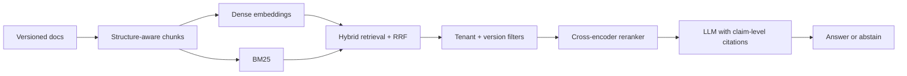

# Forge RAG Lab

**Status:** built and evaluated locally. Deployment and the walkthrough video are pending.

I built this to answer a question I kept hearing: **“Our RAG assistant gives confident answers, but we can’t tell when it’s wrong.”**

This is a small, runnable RAG assistant over versioned SaaS documentation. It shows the failures I see most often, then runs the same questions through a fixed pipeline so you can compare the two side by side.

## What you can try

- Ask a question and get an answer with a citation to the exact document version, page and block.
- Flip between the naive baseline and the fixed pipeline without changing the question.
- Open the health report to see retrieval, citation, abstention and version-disambiguation results on 80 questions.
- Try the stale-version, wrong-page, missed-detail, unanswerable and prompt-injection cases.

The live demo and the 60–90 second walkthrough are being finished. Until then, the quickstart below runs the whole thing locally.

## What I measured

I wrote 80 questions against a synthetic Helios documentation set: 24 single-hop, 16 multi-hop, 16 version-specific, 8 conflicting-version and 16 unanswerable. I ran the same questions through both pipelines.

| Check | Baseline | Fixed |
|---|---:|---:|
| Retrieval recall@10 | 0.865 | **0.943** |
| Gold-source citation coverage | 0.797 | **1.000** |
| Correct abstention | 0.800 | **1.000** |
| Version disambiguation | 0.000 | **1.000** |
| Hosted cross-check recall@10 (10 questions) | 0.833 | **0.875** |

What the numbers mean:

- The fixed pipeline found the right evidence more often.
- Every answerable answer had at least one valid citation.
- It abstained on all 16 unanswerable questions; the baseline answered all 16.
- It handled conflicting versions instead of silently choosing one.

**Caveats:** the 80-question run used a local LFM3-1.7B model, a synthetic corpus and heuristic questions. The hosted cross-check used a free OrcaRouter model on 10 questions. No LLM judge was run, so semantic answer correctness and faithfulness are not measured. These are development numbers, not a production benchmark. The full breakdown is in [`docs/evals/lfm3-refinement.md`](docs/evals/lfm3-refinement.md).

## How it works



The fixed pipeline:

1. Keeps stable block IDs so a citation can point to a page, not a vague chunk.
2. Uses ONNX BGE-base embeddings plus BM25, fused with reciprocal-rank fusion.
3. Filters by tenant and version before reranking.
4. Reranks the shortlist with `bge-reranker-v2-m3-int8`.
5. Requires every claim to carry a citation; unsupported claims are dropped.
6. Abstains when the evidence is insufficient, and sanitizes instructions found inside documents.

The baseline is deliberately naive: fixed-size chunks, dense-only retrieval, no version filter, no reranker and no abstention. That is the point — it makes the failures visible.

## Why these choices

- **ONNX BGE-base + FastEmbed instead of PyTorch/BGE-M3.** A CPU-only, $0 demo should not need a 2 GB PyTorch install. The tradeoff is documented in [ADR 0001](docs/adr/0001-onnx-embeddings.md).
- **Local LFM3-1.7B for iteration, OrcaRouter for the hosted cross-check.** The local model removes rate limits while refining prompts and parsers; the hosted model checks that the direction survives a different model. See [ADR 0002](docs/adr/0002-local-lfm3.md).
- **Versioned documents with stable block IDs.** A citation has to resolve to a page and a block. That is what makes stale-version and wrong-page failures measurable.
- **A baseline/fixed toggle.** A demo that only shows the happy path proves nothing.

## Run it

```bash
cp .env.example .env        # add a provider key, or use the local LFM3 service
make install
make dev                   # API at http://localhost:8000
make web-dev               # UI at http://localhost:3000
```

For the free local path:

```bash
lfm3 chat                  # starts LFM3-1.7B at http://127.0.0.1:8080/v1
export MODEL_PROVIDER=lfm3
```

For the hosted free path, set `MODEL_PROVIDER=orcarouter` and `ORCAROUTER_API_KEY` in `.env`. For OpenRouter, Groq, Gemini or Ollama, set the matching provider variables in `.env.example`.

Run the evaluation:

```bash
python scripts/run_eval_local.py --split all --pipeline both
python scripts/summarize_eval.py evals/reports/eval-report.json
```

## What I’d do for a client

**A RAG audit (3–5 days).** I reproduce the bad answers, measure retrieval and citation quality, and give you a short report with the failures ranked by impact and a fix list you can hand to your team.

**A fixed-scope fix.** Version filters, hybrid retrieval, citations, an evaluation set and a release gate. You get a before/after table, not a demo that only works on the happy path.

**A voice or agent build.** The same reliability approach applied to booking calls, tool-using agents or MCP integrations.

If that sounds like the problem you have, the fastest next step is a 20-minute call and three bad answers from your current assistant.

## What’s missing

- The live demo and walkthrough video are not published yet.
- The 80-question set is heuristic and needs a human review before it is treated as a headline benchmark.
- Citation precision is still noisy: the fixed pipeline cites several valid pages, which lowers the page-precision number even when coverage is perfect.
- No LLM judge yet, so semantic answer correctness and faithfulness are not measured. ALCE, span-hit and selective-accuracy metrics are also deferred.
- Prompt injection and cross-tenant isolation are covered by unit/security tests, not by the 80-question score.
- The 20-question private shadow set is planned but not yet built.
- The local LFM3 service is a development tool, not a public endpoint.

## Learn with me

I keep a [learning map](docs/learning/rag-lab.md) for this project: the papers, docs, a reading order, a concept-to-code table and exercises. If you are hiring, it is the fastest way to see how I think about the system.

## Docs

- [Scope and design](docs/scope.md)
- [Implementation status](docs/scope.md#implementation-status)
- [API contract](docs/api-contract.md)
- [Corpus schema](docs/corpus-schema.md)
- [Evaluation schema](docs/eval-schema.md)
- [Glossary](GLOSSARY.md)
- [ADR 0001 — ONNX embeddings](docs/adr/0001-onnx-embeddings.md)
- [ADR 0002 — local LFM3](docs/adr/0002-local-lfm3.md)
