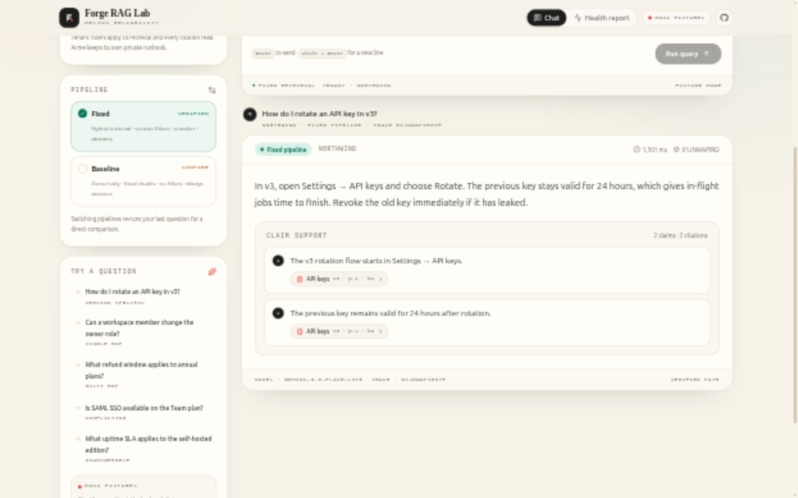
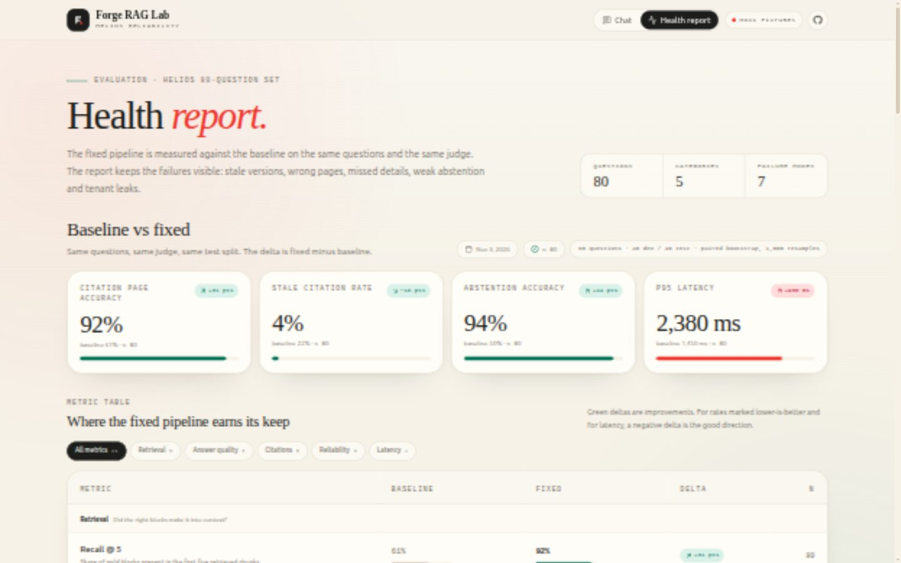

# Forge RAG Lab — web

Static Next.js UI for the Helios RAG reliability lab. It has two routes:

- **`/` — Chat:** tenant selector (`northwind` / `acme`), baseline/fixed pipeline toggle,
  question input, answer, claim-level citations and an explicit abstention state. Clicking a
  citation opens a drawer with the exact document title, version, page, block, anchor and a
  highlighted quote.
- **`/health` — Health report:** baseline-vs-fixed metric table with deltas, summary tiles and a
  filterable failure gallery covering stale citations, wrong pages, missed details, missing
  abstention, prompt injection, conflicting versions and cross-tenant leaks.

| Chat with citations | Health report |
| --- | --- |
|  |  |

More screens: [citation drawer](docs/screenshots/citation-drawer.jpg) ·
[failure gallery](docs/screenshots/health-failures.jpg)

## Requirements

- Node.js 20.9+ (developed on Node 24)
- npm 10+

## Run locally with fixtures

The UI works without the backend. With no API base configured, every request is served from
`lib/mock.ts` with a short simulated latency.

```bash
cd web
npm install
npm run dev
```

Open <http://localhost:3000>.

The fixtures include sample prompts for both tenants and both pipelines, the source block for
every citation, a measured evaluation summary and representative failure examples. The sample prompt
list mirrors `api/demo.py`, and citations point at real blocks from
`data/manifests/corpus.json`.

## Run against the live API

Set `NEXT_PUBLIC_API_BASE` to the FastAPI origin. For local development:

```bash
cd web
cp .env.example .env.local
# edit .env.local:
# NEXT_PUBLIC_API_BASE=http://localhost:8000
npm run dev
```

`NEXT_PUBLIC_*` values are inlined at **build time**, not read at runtime. After changing the
value, restart the dev server or rebuild the static export.

Endpoints used when live:

| UI action | Endpoint |
| --- | --- |
| Load sample prompts | `GET /api/demo/questions` |
| Ask a question | `POST /api/query` |
| Open a citation | `GET /api/docs/{doc_id}/blocks/{block_id}?tenant_id=...&version=...` |
| Load metrics | `GET /api/eval/summary` |
| Load failure gallery | `GET /api/eval/failures` |

The citation request appends `version` when the citation carries one, so a stale v1 citation can
resolve the v1 block instead of the current version.

The FastAPI app allows `http://localhost:3000` by default. Set `CORS_ORIGINS` on the API to a
comma-separated list that includes the deployed frontend origin. The health endpoints read
`EVAL_REPORTS_DIR` (default `evals/reports`); without a generated report the health page shows
the "awaiting evaluation report" state.

## Build the static export

```bash
cd web
npm ci
npm run build
```

The export is written to `web/out/`. It is a plain static site: no Node server is needed at
runtime. Preview it with:

```bash
npm run preview
# or: python3 -m http.server 3000 --directory out
```

Type-checking is separate:

```bash
npm run typecheck
```

## Deploy

### Cloudflare Pages

- Root directory: `web`
- Build command: `npm ci && npm run build`
- Build output directory: `out`
- Optional environment variable: `NEXT_PUBLIC_API_BASE=https://your-api.example.com`

### GitHub Pages

For a project site served from `/forge-rag-lab`, build with the repository sub-path:

```bash
NEXT_PUBLIC_BASE_PATH=/forge-rag-lab npm run build
```

Publish the contents of `web/out`. `public/.nojekyll` is included so Next's `_next/` assets are
served correctly. For a user/organisation site at the root, leave `NEXT_PUBLIC_BASE_PATH` unset.

## Project structure

```text
web/
├── app/
│   ├── globals.css        # Tailwind theme, paper/ink palette, motion
│   ├── layout.tsx         # metadata, header, footer
│   ├── page.tsx           # chat route
│   └── health/page.tsx    # health report route
├── components/
│   ├── chat/              # console, answer card, citation drawer
│   ├── health/            # metric table and failure gallery
│   ├── site-header.tsx
│   └── site-footer.tsx
├── lib/
│   ├── api.ts             # live/mock switch, fetch helpers
│   ├── mock.ts            # fixture corpus, query responses, eval data
│   ├── metric-meta.ts     # metric labels, units, groups, formatting
│   ├── failure-meta.ts    # failure labels and explanations
│   ├── runtime.ts         # NEXT_PUBLIC_API_BASE / mode
│   └── types.ts           # API contract types
└── docs/screenshots/
```

## Notes

- No paid UI libraries. The stack is Next.js, React, Tailwind CSS and
  [Lucide](https://lucide.dev) icons (ISC).
- The UI is responsive down to phone widths. Tables scroll horizontally on small screens.
- The citation drawer is keyboard accessible: focus moves into the drawer, `Tab` is trapped
  inside it, `Esc` closes it and focus returns to the trigger.
- Mock data is synthetic Helios content. No real customer or employer data is used.

See the repository's [`docs/api-contract.md`](../docs/api-contract.md) and
[`docs/scope.md`](../docs/scope.md) for the contract and product scope.
